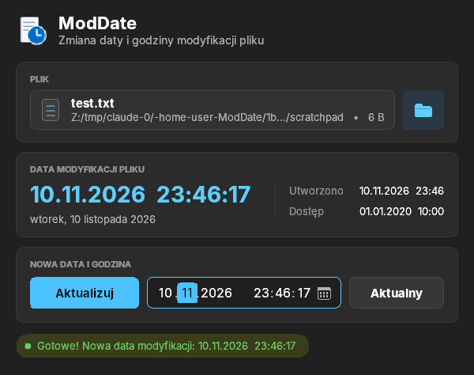

# ModDate

Mała aplikacja okienkowa w ciemnym motywie dla Windows (C++ / WinAPI) do zmiany daty i godziny modyfikacji pliku.

  

**Gotowy plik:** [`release/ModDate.exe`](release/ModDate.exe), jeden plik bez instalacji i bez dodatkowych DLL.

## Obsługa

1. Kliknij pole pliku lub przycisk z ikoną folderu i wybierz plik. Możesz też przeciągnąć plik do okna albo na ikonę `ModDate.exe`.
2. W karcie **Data modyfikacji pliku** widać obecną datę modyfikacji (oraz datę utworzenia i ostatniego dostępu).
3. W polu obok przycisku **Aktualizuj** wpisz nową datę i godzinę (`dd.MM.rrrr  GG:mm:ss`) albo wybierz dzień z kalendarza (ikona po prawej stronie pola). Kalendarz jest po polsku, tydzień zaczyna się od poniedziałku, a przycisk „Dziś” wybiera dzisiejszą datę.
   W polu można też zmieniać wartości strzałkami ↑/↓ lub kółkiem myszy, a ←/→ przechodzi między dniem, miesiącem, rokiem, godziną, minutą i sekundą.
   Przycisk **Aktualny** wstawia do pola bieżącą datę i godzinę.
4. Kliknij **Aktualizuj**, a data modyfikacji pliku zostanie zmieniona.

Data jest podawana w czasie lokalnym (z uwzględnieniem czasu letniego i zimowego).

## Kompilacja

- **Visual Studio:** uruchom `build.bat` w *Developer Command Prompt*.
- **MinGW-w64 (Linux/MSYS2):** `./build.sh`
- **GitHub Actions:** każdy push buduje `ModDate.exe`, który można pobrać z zakładki *Actions* jako artefakt.
